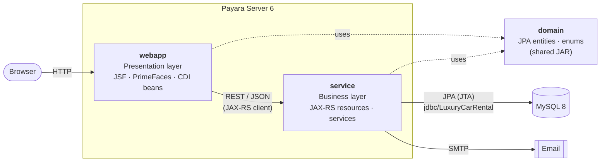
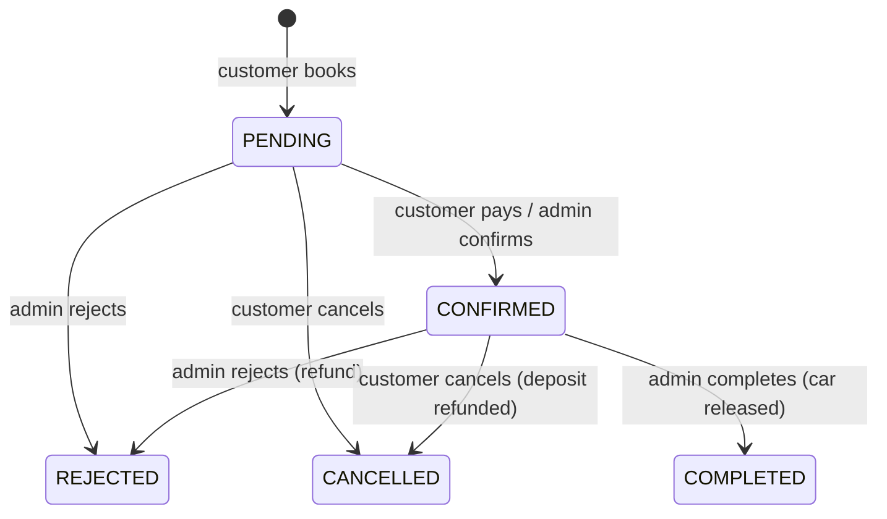

# Luxury Car Rental

A full-stack luxury car rental platform built with **Jakarta EE 10** using a classic **three-layer architecture**:
a JSF web front end talks to a JAX-RS REST service, which persists a shared JPA domain model in MySQL.
Everything runs on Payara and starts with a single `docker compose up`.

Developed for the *Software Architecture* course at the University of Lausanne (UNIL), 2025.

<!--
## Screenshots
Add screenshots to docs/screenshots/ and remove this comment:

| Customer – car catalogue | Customer – booking | Admin – dashboard |
|---|---|---|
|  |  |  |
-->

## Features

**Customers**
- Register, log in, and reset a forgotten password with an emailed verification code
- Browse the fleet, filter and fuzzy-search cars, view detailed specs
- Book a car for a date range, pay from an account balance (deposit + rental cost), cancel with refund, and track order status
- Receive a booking confirmation email with a PDF attachment (iText)

**Administrators**
- Dashboard with fleet and booking overview
- Manage car types, individual cars, and customers (full CRUD)
- Confirm, reject (with reason), and complete bookings

## Architecture



| Module | Packaging | Responsibility |
|---|---|---|
| [`domain`](domain) | JAR | Entities (`Car`, `CarType`, `Customer`, `Admin`, `Booking`) and enums, shared by both other modules. Unit-tested with JUnit 5. |
| [`service`](service) | WAR | REST API under `/luxurycarrental/api`; business rules (availability, booking state machine, payments, verification codes); persistence via JPA; email and PDF generation. |
| [`webapp`](webapp) | WAR | JSF pages for customers and admins; REST clients that call the service layer. |

The web layer never touches the database: every read and write goes through the REST API.
That keeps the layers independent, so the service could serve a mobile app or a different front end without changes.

### Booking lifecycle



## Tech stack

| Area | Technology |
|---|---|
| Language / platform | Java 17, Jakarta EE 10 |
| Presentation | Jakarta Faces (JSF), PrimeFaces 14, CDI |
| API | JAX-RS (Jersey), JSON-B |
| Persistence | Jakarta Persistence (JPA), MySQL 8 |
| Other | Jakarta Mail, iText 7 (PDF) |
| Build / run | Maven multi-module, Docker, Payara Server 6 |
| Testing | JUnit 5 |

## Quick start

Prerequisites: Docker with Docker Compose. No local JDK or Maven needed.

```bash
git clone https://github.com/embarky/LuxuryCarRental.git
cd LuxuryCarRental
cp .env.example .env          # adjust passwords if you like
docker compose up --build
```

When Payara has finished deploying (about a minute):

| What | URL |
|---|---|
| Web application | http://localhost:8080/LuxuryCarRental/ |
| REST API | http://localhost:8080/luxurycarrental/api/cars |
| Payara admin console | http://localhost:4848 |

Optional demo data (one admin, three car types and three cars):

```bash
./scripts/seed-demo-data.sh
```

Demo admin login: `admin@example.com` / `admin123`.

Emails are printed to the server log (`docker compose logs -f app`) unless you set `MAIL_USERNAME` and `MAIL_APP_PASSWORD` in `.env`.

### Building without Docker

```bash
./mvnw clean package      # builds domain -> service -> webapp and runs the tests
```

The WARs end up in `service/target/` and `webapp/target/`, and can be deployed to any Jakarta EE 10 server
that has a `jdbc/LuxuryCarRental` data source.

## REST API overview

| Resource | Endpoints |
|---|---|
| `/cars` | `GET`, `GET /{id}`, `GET /search?q=&status=&minPrice=&maxPrice=&carTypeId=`, `POST`, `PUT /{id}`, `DELETE /{id}` |
| `/cartypes` | `GET`, `GET /{id}`, `POST`, `PUT /{id}`, `DELETE /{id}` |
| `/customers` | CRUD, login, email verification, password reset |
| `/admins` | CRUD, `POST /login`, `POST /password-reset-code`, `PUT /reset-password` |
| `/bookings` | CRUD, by customer / car, `POST /{id}/pay`, `PUT /{id}/confirm`, `POST /{id}/reject`, `PUT /{id}/cancel`, `PUT /{id}/complete` |

## Project structure

```
.
├── pom.xml                 # parent POM (modules: domain, service, webapp)
├── domain/                 # JPA entities + enums + unit tests
├── service/                # REST API + business logic
├── webapp/                 # JSF web UI
├── docker/                 # Payara post-boot commands (data source, deployment)
├── Dockerfile              # multi-stage: Maven build -> Payara image
├── docker-compose.yml      # MySQL + Payara
├── .env.example            # configuration template
└── scripts/seed-demo-data.sh
```

## Known limitations and next steps

This is a course project, and some production concerns were deliberately left out:

- Passwords are stored in plain text. Next step: hash them with bcrypt or Argon2.
- Authentication is session-based in the web tier only, and the REST API is not secured. Next step: JWT or Jakarta Security.
- Payment is simulated with an account balance; there is no payment provider.
- Schema is generated by JPA at startup. Next step: migrations with Flyway.
- Integration tests for the REST layer (e.g. Testcontainers + Arquillian) are not included yet.

## History

The project was originally developed as three separate repositories (`LuxuryCarRentalDomain`,
`LuxuryCarRentalService`, `LuxuryCarRentalWebapp`) and merged into this monorepo with the full commit history preserved.

## Author

**Hang Yang** – [GitHub](https://github.com/embarky)
