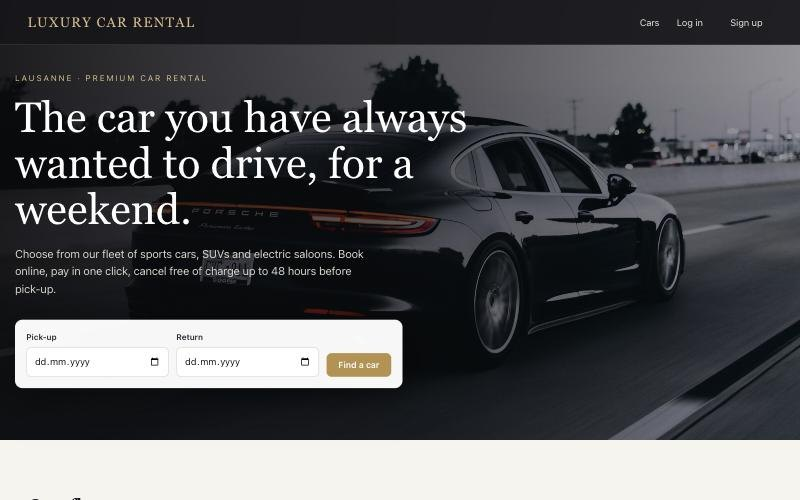
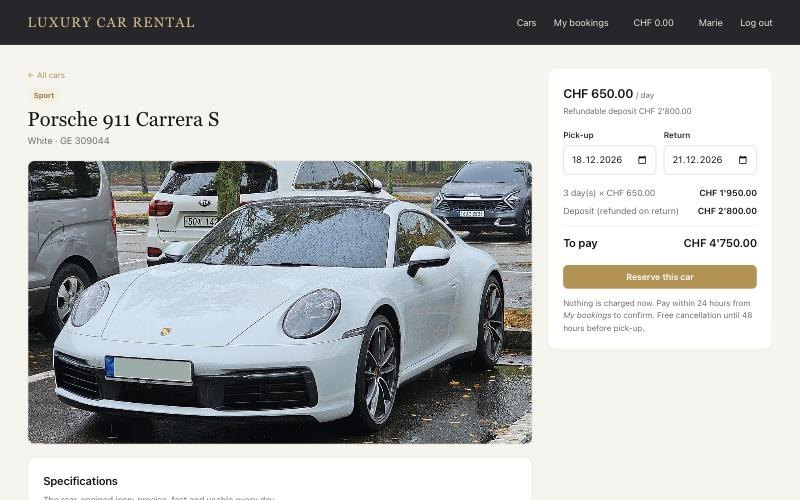
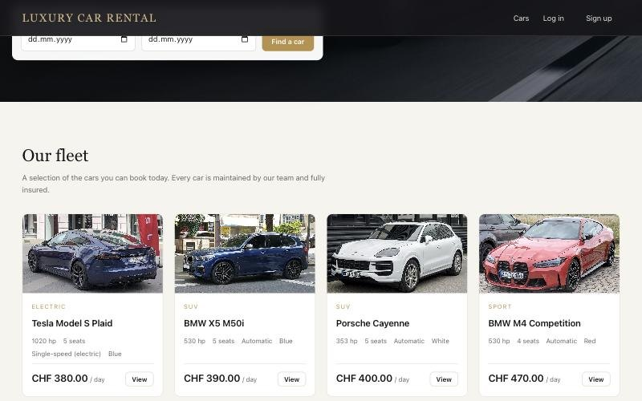
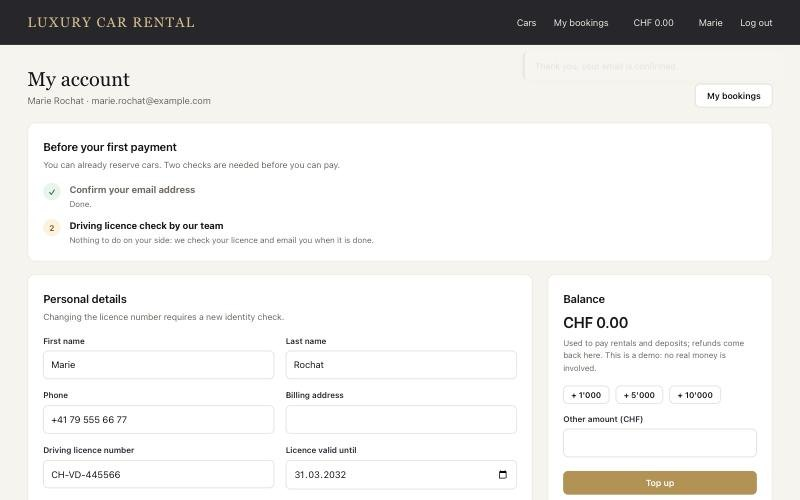
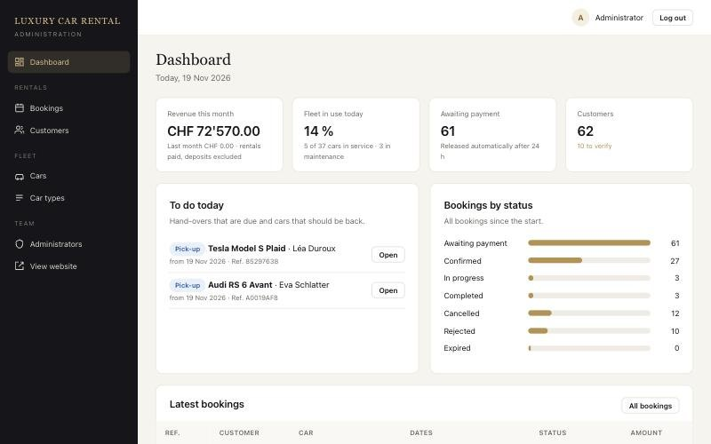
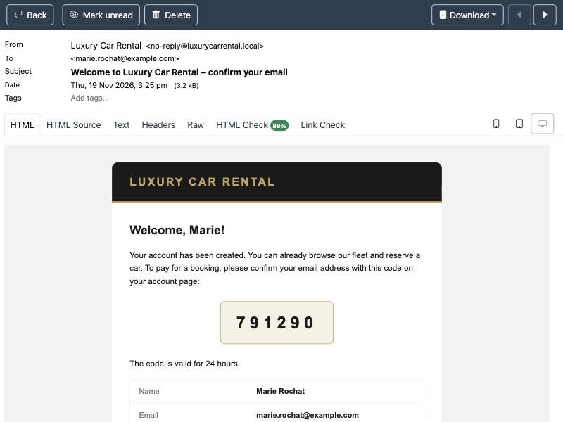
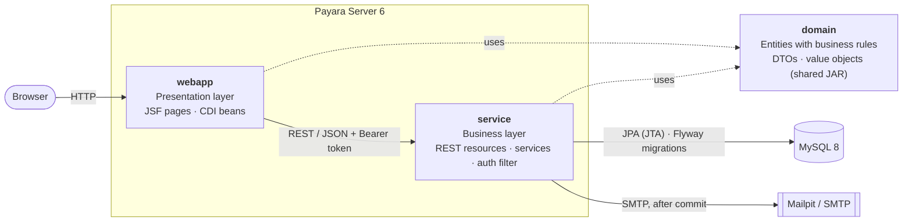
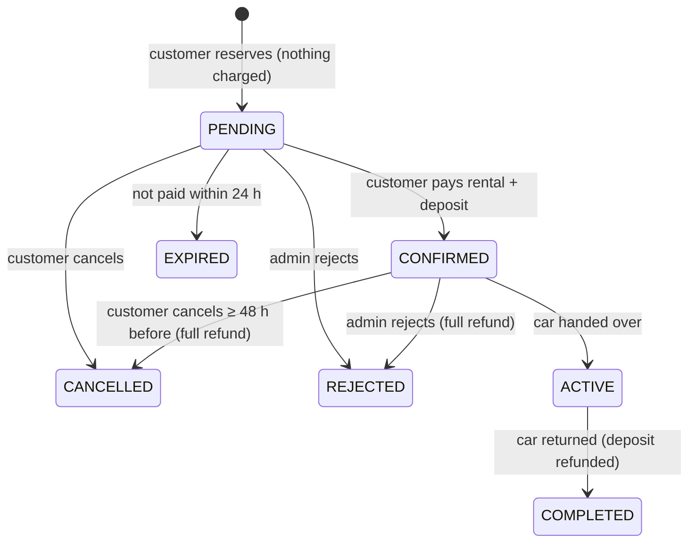

# Luxury Car Rental

[](https://github.com/embarky/LuxuryCarRental/actions/workflows/ci.yml)


[](LICENSE)

A full-stack car rental platform built with **Jakarta EE 10** in a classic **three-layer architecture**:
a JSF web front end calls a secured JAX-RS REST service, which keeps a shared domain model in MySQL
through JPA. Everything runs on Payara and starts with a single `docker compose up`.

## Screenshots

| Home page | Car page with live price |
|---|---|
|  |  |
| **Fleet** | **Checks before the first payment** |
|  |  |
| **Admin dashboard** | **Welcome email with confirmation code (Mailpit)** |
|  |  |

## Features

**Customers**
- Sign up with date of birth and driving licence (age, licence validity, email, phone and password policy are checked)
- Browse and reserve straight away; before the first payment the email address is confirmed with a code
  and the driving licence is checked by the team
- Search the fleet by text, category and price, and see **only the cars free on the chosen dates**
- Live price on the car page (days × daily rate + refundable deposit), with the dates already booked
- Reserve, then pay from an account balance within 24 hours; free cancellation until 48 hours before pick-up
- *My account*: personal details, licence, balance top-up, password; *My bookings* with PDF confirmations
- HTML email at every step (welcome with confirmation code, licence verified, booking received and paid with PDF, cancelled, rejected, expired, completed)

**Administrators** (separate staff login, no public sign-up)
- Dashboard: revenue of the month, fleet utilisation today, bookings awaiting payment, hand-overs and returns due
- Bookings: hand over a car, take it back (deposit refunded), or reject with a reason (full refund if paid)
- Customers: verify identity after checking the licence; customer page with balance and booking history
- Fleet: cars and car types, maintenance status; administrator accounts

## Architecture



| Module | Packaging | Responsibility |
|---|---|---|
| [`domain`](domain) | JAR | Entities (`Car`, `CarType`, `Customer`, `Admin`, `Booking`), the booking state machine, `DateRange` and money rules, request/response DTOs. Unit-tested without a database. |
| [`service`](service) | WAR | REST API under `/luxurycarrental/api`: loads data, checks what needs the database (free dates, ownership), authenticates requests, sends emails and PDFs. |
| [`webapp`](webapp) | WAR | JSF pages for customers and administrators; one API client that adds the user's token and shows the API's error messages. |

The web layer never touches the database: every read and write goes through the REST API, so the
service could serve a mobile app without changes.

### Booking lifecycle



Whatever path a booking takes, the customer ends up paying exactly the rental, or nothing.
Each transition is a method of `Booking` that checks the current state and moves the money;
[`BookingTest`](domain/src/test/java/ch/unil/softarch/luxurycarrental/domain/BookingTest.java) covers every path.

### Design decisions

| Decision | Why |
|---|---|
| Business rules in the domain objects (`booking.pay()`, `customer.debit()`) instead of setters called from services | The rules cannot be bypassed and are tested without a server or database. |
| Availability computed from bookings by date, not stored as a car status | A car can be free next week while booked this week. `CarStatus` only means "in service" or "in maintenance". |
| Car row locked (`SELECT … FOR UPDATE`) while checking for overlapping bookings, plus `@Version` | Two customers booking the same car at the same moment cannot both succeed. |
| `BigDecimal` for all amounts | No rounding errors with money. |
| Signed tokens (HMAC-SHA256) and a deny-by-default filter: endpoints are `@Public`, `@LoggedIn` (own data only) or admin-only | A new endpoint is never accidentally public; customers cannot read or change other customers' data. |
| Passwords hashed with PBKDF2 (JDK, no extra library); email codes (password reset, email confirmation) hashed in the database, single use, 5 attempts | Nothing secret is stored or returned in clear text. |
| Email confirmation and licence check required to **pay**, not to sign up | Visitors can explore and reserve without friction; the checks sit where the risk is (money). |
| Schema defined by versioned Flyway scripts, JPA only maps it | Every environment gets exactly the same schema, and each change is reviewed as SQL ([`db/migration`](service/src/main/resources/db/migration)). |
| Emails fired as CDI events observed `AFTER_SUCCESS` and sent on the managed executor | A rolled-back change never sends an email, and a slow mail server never slows down the API. |
| One exception mapper: business errors → 400/409, missing data → 404, unexpected errors → 500 with a generic message | Clients get a clear JSON error; internal details stay in the server log. |

The longer reasoning, with the trade-offs, is in the [architecture decision records](docs/adr/README.md).

## Tech stack

| Area | Technology |
|---|---|
| Language / platform | Java 17, Jakarta EE 10 |
| Presentation | Jakarta Faces (JSF), CDI, one shared CSS design system |
| API | JAX-RS, JSON-B, token authentication |
| Persistence | Jakarta Persistence (JPA, EclipseLink), MySQL 8, Flyway migrations |
| Other | Jakarta Mail with HTML templates, iText 7 (PDF), Mailpit (local SMTP) |
| Build / run | Maven multi-module, Docker Compose, Payara Server 6 |
| Testing | JUnit 5 unit tests; integration tests with Testcontainers (MySQL, Mailpit, Payara); GitHub Actions CI |

## Quick start

Prerequisites: Docker with Docker Compose. No local JDK or Maven needed.

```bash
git clone https://github.com/embarky/LuxuryCarRental.git
cd LuxuryCarRental
cp .env.example .env          # adjust passwords and the token secret if you like
docker compose up --build
```

When Payara has finished deploying (about a minute), the `seeder` container fills the empty
database through the REST API: 13 luxury models, 40 cars, 60 customers and about 100 bookings in every
state. Follow it with `docker compose logs -f seeder`. It runs only on an empty database.

| What | URL |
|---|---|
| Web application | http://localhost:8080/LuxuryCarRental/ |
| Admin area | http://localhost:8080/LuxuryCarRental/pages/staff-login.xhtml |
| REST API | http://localhost:8080/luxurycarrental/api/cars/search |
| Mailpit (all emails sent by the app) | http://localhost:8025 |

Demo logins:

| Role | Email | Password |
|---|---|---|
| Administrator | `admin@example.com` | `admin123` |
| Customer (ready to pay, CHF 50'000 balance) | `customer@example.com` | `customer123` |

Every generated customer also uses the password `customer123`.

All emails (welcome, reset codes, booking confirmations with PDF, ...) are caught by
[Mailpit](https://mailpit.axllent.org/) and shown at http://localhost:8025; nothing reaches real inboxes.
To send real emails, point the `MAIL_*` settings in `.env` to an SMTP provider.

To start again from an empty database: `docker compose down -v && docker compose up --build`.
(A database created by a version before the Flyway migrations has to be reset this way once.)

## Tests

```bash
./mvnw clean verify       # unit tests, then integration tests (needs Docker)
```

| Level | What is tested | Where |
|---|---|---|
| Unit | Every booking transition and the money it moves, date ranges, balance rules, password hashing, tokens | `domain/src/test`, `service/src/test` |
| Integration | The real system: Payara with the built WARs, MySQL with the Flyway schema, Mailpit. Tests talk to the REST API like a client | [`integration-tests`](integration-tests/src/test/java/ch/unil/softarch/luxurycarrental/it) |

The integration tests cover, among others:

- **No double booking**: 10 requests for the same car and dates sent at the same moment give exactly
  one booking (one `200`, nine `409`), checked in the database;
- **Access rules**: `401` without or with a tampered token, `403` for another customer's data or
  admin functions, no password hash in any response;
- **The customer journey**: sign-up, confirmation code read from the email in Mailpit, licence check,
  payment, cancellation, with the balance checked after each step; password reset with a one-time code.

[GitHub Actions](.github/workflows/ci.yml) runs all of them and builds the Docker image on every push.

### Building without Docker

```bash
./mvnw clean package      # builds domain -> service -> webapp and runs the unit tests
```

## REST API overview

Access: **public**, **own** (logged-in customer, own data only; administrators may access all), **admin**.

| Endpoint | Access | Purpose |
|---|---|---|
| `POST /customers` · `POST /customers/login` | public | Sign up · log in (returns a token) |
| `GET /cars/search?q=&category=&maxPrice=&start=&end=` | public | Bookable cars, free on the dates |
| `GET /cars/{id}` · `GET /cars/{id}/booked` · `GET /cartypes` | public | Car details · dates already taken · models |
| `GET/PUT /customers/{id}` · `POST /customers/{id}/top-up` · `PUT /customers/{id}/password` | own | Account |
| `PUT /customers/{id}/email-confirmation` (code) · `POST …/email-confirmation` (new code) | own | Confirm the email address |
| `POST /bookings` · `GET /bookings/customer/{id}` · `GET /bookings/{id}/pdf` | own | Reserve · list · confirmation |
| `POST /bookings/{id}/pay` · `POST /bookings/{id}/cancel` | own | Pay · cancel |
| `POST /bookings/{id}/pick-up` · `/complete` · `/reject` | admin | Hand over · take back · reject with reason |
| `GET /bookings?status=` · `GET /customers` · `PUT /customers/{id}/verified` · `PUT …/email-verified` | admin | Back office |
| `POST/PUT/DELETE /cars`, `/cartypes` · `GET/POST/DELETE /admins` | admin | Fleet and staff |
| `POST /admins/login` · `POST/PUT …/password-reset-code`, `…/reset-password` | public | Staff login · password reset |

Errors are always JSON: `{"status": 409, "message": "This car is already booked for some of these dates."}`.

## Project structure

```
.
├── pom.xml                 # parent POM (modules: domain, service, webapp, integration-tests)
├── domain/                 # entities with business rules, DTOs, unit tests
├── service/                # REST API, services, security, emails, PDF
│   └── src/main/resources/db/migration/   # Flyway scripts V1, V2, ...
├── webapp/                 # JSF pages, beans, API client, CSS
├── integration-tests/      # Testcontainers tests of the running system
├── .github/workflows/      # CI: build, tests, Docker image
├── docs/                   # design decisions (adr/), image credits
├── docker/                 # Payara post-boot commands (data source, deployment)
├── Dockerfile              # multi-stage: Maven build -> Payara image
├── docker-compose.yml      # MySQL + Payara + Mailpit + demo data seeder
├── .env.example            # configuration template
└── scripts/seeder/         # demo data generator (Python, Faker), run by Compose
```

## Known limitations and next steps

- **Payments are simulated** with an account balance; a real system would use a payment provider
  (and its webhooks) and keep the balance only as a ledger.
- **Tokens cannot be revoked** before they expire (8 hours): logging out only forgets the token in the
  browser. A token blacklist or short-lived tokens with refresh tokens would fix this
  ([ADR 3](docs/adr/0003-stateless-signed-tokens.md)).
- **The web layer calls the API over HTTP inside the same server.** This keeps the layers honest but
  costs a network hop per call; the dashboard also aggregates in the web layer instead of asking the
  API for statistics.
- **No rate limiting** on login and code endpoints (codes are limited to 5 attempts each).
- Emails are sent in-process after commit; if the server stops right then, an email can be lost.
  An outbox table would make delivery reliable.
- Car photos are loaded from Wikimedia Commons ([credits](docs/IMAGE_CREDITS.md)).

## History

**2025 – course project.** The application was a group project of five students in the *Software
Architecture* course at UNIL. The software and architecture design (the three layers, the domain model,
the REST interface) was worked out together by the group. I built the implementation of the original
version on my own: the domain, service and web layers, at that time in three separate repositories
(`LuxuryCarRentalDomain`, `LuxuryCarRentalService`, `LuxuryCarRentalWebapp`).

**Since November 2026 – own work.** I merged the three repositories into this one, keeping the full
commit history, and reworked the project on my own with the help of an AI coding assistant (Claude):
booking rules and money handling, API security, email confirmation, Flyway migrations, integration
tests with Testcontainers, CI, demo data, a new user interface and the design records in `docs/adr`.

## License

The code is available under the [MIT License](LICENSE). The car photos are not covered by it: they keep
their own free licences, listed in [docs/IMAGE_CREDITS.md](docs/IMAGE_CREDITS.md).

## Author

**Hang Yang** – [GitHub](https://github.com/embarky)
