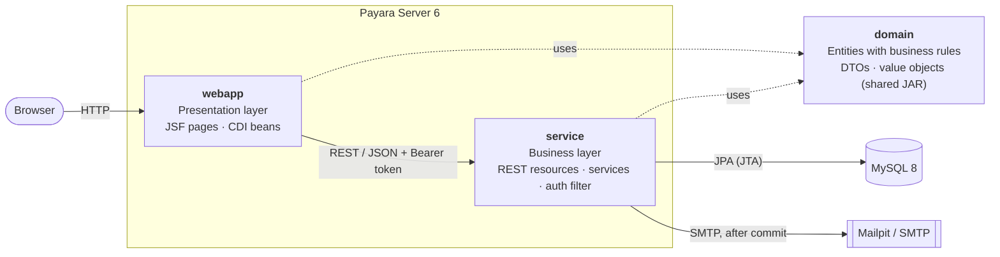
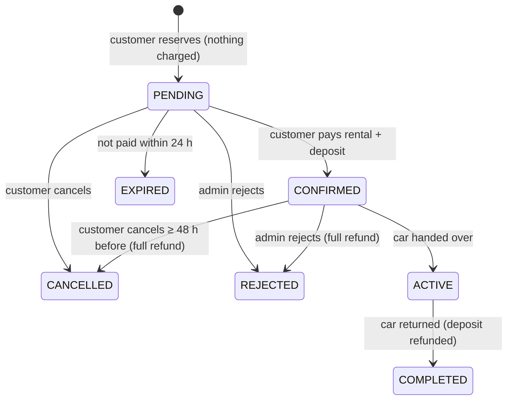

# Luxury Car Rental

A full-stack car rental platform built with **Jakarta EE 10** in a classic **three-layer architecture**:
a JSF web front end calls a secured JAX-RS REST service, which keeps a shared domain model in MySQL
through JPA. Everything runs on Payara and starts with a single `docker compose up`.

Developed for the *Software Architecture* course at the University of Lausanne (UNIL), 2025.

<!--
## Screenshots
Add screenshots to docs/screenshots/ and remove this comment:

| Car catalogue | Booking a car | Admin dashboard |
|---|---|---|
|  |  |  |
-->

## Features

**Customers**
- Sign up with date of birth and driving licence (age, licence validity, email, phone and password policy are checked)
- Search the fleet by text, category and price, and see **only the cars free on the chosen dates**
- Live price on the car page (days × daily rate + refundable deposit), with the dates already booked
- Reserve, then pay from an account balance within 24 hours; free cancellation until 48 hours before pick-up
- *My account*: personal details, licence, balance top-up, password; *My bookings* with PDF confirmations
- HTML email at every step (welcome, verification, booking received with PDF, paid, cancelled, rejected, expired, completed)

**Administrators** (separate staff login, no public sign-up)
- Dashboard: revenue of the month, fleet utilisation today, bookings awaiting payment, hand-overs and returns due
- Bookings: hand over a car, take it back (deposit refunded), or reject with a reason (full refund if paid)
- Customers: verify identity after checking the licence; customer page with balance and booking history
- Fleet: cars and car types, maintenance status; administrator accounts

## Architecture



| Module | Packaging | Responsibility |
|---|---|---|
| [`domain`](domain) | JAR | Entities (`Car`, `CarType`, `Customer`, `Admin`, `Booking`), the booking state machine, `DateRange` and money rules, request/response DTOs. Unit-tested without a database. |
| [`service`](service) | WAR | REST API under `/luxurycarrental/api`: loads data, checks what needs the database (free dates, ownership), authenticates requests, sends emails and PDFs. |
| [`webapp`](webapp) | WAR | JSF pages for customers and administrators; one API client that adds the user's token and shows the API's error messages. |

The web layer never touches the database: every read and write goes through the REST API, so the
service could serve a mobile app without changes.

### Booking lifecycle



Whatever path a booking takes, the customer ends up paying exactly the rental, or nothing.
Each transition is a method of `Booking` that checks the current state and moves the money;
[`BookingTest`](domain/src/test/java/ch/unil/softarch/luxurycarrental/domain/BookingTest.java) covers every path.

### Design decisions

| Decision | Why |
|---|---|
| Business rules in the domain objects (`booking.pay()`, `customer.debit()`) instead of setters called from services | The rules cannot be bypassed and are tested without a server or database. |
| Availability computed from bookings by date, not stored as a car status | A car can be free next week while booked this week. `CarStatus` only means "in service" or "in maintenance". |
| Car row locked (`SELECT … FOR UPDATE`) while checking for overlapping bookings, plus `@Version` | Two customers booking the same car at the same moment cannot both succeed. |
| `BigDecimal` for all amounts | No rounding errors with money. |
| Signed tokens (HMAC-SHA256) and a deny-by-default filter: endpoints are `@Public`, `@LoggedIn` (own data only) or admin-only | A new endpoint is never accidentally public; customers cannot read or change other customers' data. |
| Passwords hashed with PBKDF2 (JDK, no extra library); reset codes hashed in the database, single use, 10 minutes | Nothing secret is stored or returned in clear text. |
| Emails fired as CDI events observed `AFTER_SUCCESS` and sent on the managed executor | A rolled-back change never sends an email, and a slow mail server never slows down the API. |
| One exception mapper: business errors → 400/409, missing data → 404, unexpected errors → 500 with a generic message | Clients get a clear JSON error; internal details stay in the server log. |

## Tech stack

| Area | Technology |
|---|---|
| Language / platform | Java 17, Jakarta EE 10 |
| Presentation | Jakarta Faces (JSF), CDI, one shared CSS design system |
| API | JAX-RS, JSON-B, token authentication |
| Persistence | Jakarta Persistence (JPA, EclipseLink), MySQL 8 |
| Other | Jakarta Mail with HTML templates, iText 7 (PDF), Mailpit (local SMTP) |
| Build / run | Maven multi-module, Docker Compose, Payara Server 6 |
| Testing | JUnit 5 (domain rules, password hashing, tokens) |

## Quick start

Prerequisites: Docker with Docker Compose. No local JDK or Maven needed.

```bash
git clone https://github.com/embarky/LuxuryCarRental.git
cd LuxuryCarRental
cp .env.example .env          # adjust passwords and the token secret if you like
docker compose up --build
```

When Payara has finished deploying (about a minute), the `seeder` container fills the empty
database through the REST API: 13 luxury models, 40 cars, 60 customers and about 100 bookings in every
state. Follow it with `docker compose logs -f seeder`. It runs only on an empty database.

| What | URL |
|---|---|
| Web application | http://localhost:8080/LuxuryCarRental/ |
| Admin area | http://localhost:8080/LuxuryCarRental/pages/staff-login.xhtml |
| REST API | http://localhost:8080/luxurycarrental/api/cars/search |
| Mailpit (all emails sent by the app) | http://localhost:8025 |

Demo logins:

| Role | Email | Password |
|---|---|---|
| Administrator | `admin@example.com` | `admin123` |
| Customer (verified, CHF 50'000 balance) | `customer@example.com` | `customer123` |

Every generated customer also uses the password `customer123`.

All emails (welcome, reset codes, booking confirmations with PDF, ...) are caught by
[Mailpit](https://mailpit.axllent.org/) and shown at http://localhost:8025; nothing reaches real inboxes.
To send real emails, point the `MAIL_*` settings in `.env` to an SMTP provider.

To start again from an empty database: `docker compose down -v && docker compose up --build`.

### Building without Docker

```bash
./mvnw clean package      # builds domain -> service -> webapp and runs the tests
```

## REST API overview

Access: **public**, **own** (logged-in customer, own data only; administrators may access all), **admin**.

| Endpoint | Access | Purpose |
|---|---|---|
| `POST /customers` · `POST /customers/login` | public | Sign up · log in (returns a token) |
| `GET /cars/search?q=&category=&maxPrice=&start=&end=` | public | Bookable cars, free on the dates |
| `GET /cars/{id}` · `GET /cars/{id}/booked` · `GET /cartypes` | public | Car details · dates already taken · models |
| `GET/PUT /customers/{id}` · `POST /customers/{id}/top-up` · `PUT /customers/{id}/password` | own | Account |
| `POST /bookings` · `GET /bookings/customer/{id}` · `GET /bookings/{id}/pdf` | own | Reserve · list · confirmation |
| `POST /bookings/{id}/pay` · `POST /bookings/{id}/cancel` | own | Pay · cancel |
| `POST /bookings/{id}/pick-up` · `/complete` · `/reject` | admin | Hand over · take back · reject with reason |
| `GET /bookings?status=` · `GET /customers` · `PUT /customers/{id}/verified` | admin | Back office |
| `POST/PUT/DELETE /cars`, `/cartypes` · `GET/POST/DELETE /admins` | admin | Fleet and staff |
| `POST /admins/login` · `POST/PUT …/password-reset-code`, `…/reset-password` | public | Staff login · password reset |

Errors are always JSON: `{"status": 409, "message": "This car is already booked for some of these dates."}`.

## Project structure

```
.
├── pom.xml                 # parent POM (modules: domain, service, webapp)
├── domain/                 # entities with business rules, DTOs, unit tests
├── service/                # REST API, services, security, emails, PDF
├── webapp/                 # JSF pages, beans, API client, CSS
├── docker/                 # Payara post-boot commands (data source, deployment)
├── Dockerfile              # multi-stage: Maven build -> Payara image
├── docker-compose.yml      # MySQL + Payara + Mailpit + demo data seeder
├── .env.example            # configuration template
└── scripts/seeder/         # demo data generator (Python, Faker), run by Compose
```

## Known limitations and next steps

- Payments are simulated with an account balance; there is no payment provider.
- The schema is generated by JPA at start-up. Next step: migrations with Flyway.
- Integration tests of the REST layer against a real database (Testcontainers) are not included yet.
- Tokens are stateless and cannot be revoked before they expire (8 hours).

## History

The project was originally developed as three separate repositories (`LuxuryCarRentalDomain`,
`LuxuryCarRentalService`, `LuxuryCarRentalWebapp`) and merged into this monorepo with the full commit
history preserved. In November 2026 it was reworked with the help of an AI coding assistant (Claude):
booking rules and money handling, API security, emails, demo data and a new user interface.

## Author

**Hang Yang** – [GitHub](https://github.com/embarky)
