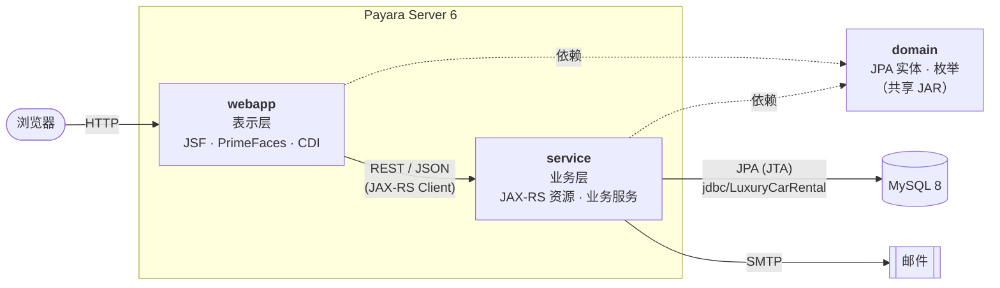

# 豪华汽车租赁平台 Luxury Car Rental

[English](README.md) | [中文](README.zh-CN.md)

基于 **Jakarta EE 10** 的豪华汽车租赁全栈应用，采用经典的**三层架构**：
JSF 前端通过 REST 调用 JAX-RS 服务层，服务层用 JPA 把共享的领域模型持久化到 MySQL。
整个系统运行在 Payara 上，一条 `docker compose up` 即可启动。

洛桑大学（UNIL）*软件架构* 课程项目，2025 年。

## 功能

**客户端**
- 注册、登录，忘记密码时通过邮件验证码重置
- 浏览车队，按条件筛选、模糊搜索车辆，查看详细参数
- 按日期预订车辆，用账户余额支付（押金 + 租金），取消并退款，跟踪订单状态
- 收到附带 PDF 确认单的预订确认邮件（iText 生成）

**管理端**
- 仪表盘：车辆总数、进行中订单、客户数、月收入
- 车型、车辆、客户的完整增删改查
- 确认、拒绝（附原因）、完成订单

## 架构



| 模块 | 打包 | 职责 |
|---|---|---|
| [`domain`](domain) | JAR | 实体（`Car`、`CarType`、`Customer`、`Admin`、`Booking`）和枚举，被另外两个模块共享；有 JUnit 5 单元测试 |
| [`service`](service) | WAR | `/luxurycarrental/api` 下的 REST API；业务规则（车辆可用性、订单状态机、支付、验证码）；JPA 持久化；邮件和 PDF |
| [`webapp`](webapp) | WAR | 面向客户和管理员的 JSF 页面；调用服务层的 REST 客户端 |

Web 层不直接访问数据库，所有读写都经过 REST API。各层因此相互独立，服务层不用改动就能给移动端或其他前端使用。

## 技术栈

Java 17 · Jakarta EE 10 · JSF / PrimeFaces 14 · JAX-RS · JPA · MySQL 8 · Jakarta Mail · iText 7 · Maven 多模块 · Docker · Payara 6 · JUnit 5

## 快速开始

只需要安装 Docker（含 Docker Compose），本地不需要 JDK 或 Maven。

```bash
git clone https://github.com/embarky/LuxuryCarRental.git
cd LuxuryCarRental
cp .env.example .env          # 可按需修改密码
docker compose up --build
```

Payara 部署完成后（约一分钟）：

| 内容 | 地址 |
|---|---|
| Web 应用 | http://localhost:8080/LuxuryCarRental/ |
| REST API | http://localhost:8080/luxurycarrental/api/cars |
| Payara 管理控制台 | http://localhost:4848 |

可选：导入演示数据（1 个管理员、3 个车型、3 辆车）：

```bash
./scripts/seed-demo-data.sh
```

演示管理员账号：`admin@example.com` / `admin123`。

如果没有在 `.env` 里设置 `MAIL_USERNAME` 和 `MAIL_APP_PASSWORD`，邮件不会真正发出，只会打印到服务器日志（`docker compose logs -f app`）。

不用 Docker 构建：`./mvnw clean package`。

## 已知局限与后续计划

- 密码目前明文存储，计划改用 bcrypt / Argon2 哈希
- REST API 未做鉴权，计划引入 JWT 或 Jakarta Security
- 支付用账户余额模拟，没有接入真实支付渠道
- 表结构由 JPA 启动时生成，计划改用 Flyway 管理迁移
- 尚未加入 REST 层集成测试（如 Testcontainers）

## 项目历史

项目最初分为三个仓库（`LuxuryCarRentalDomain`、`LuxuryCarRentalService`、`LuxuryCarRentalWebapp`），后合并为本仓库，并保留了完整的提交历史。

## 作者

**Hang Yang**– [GitHub](https://github.com/embarky)
